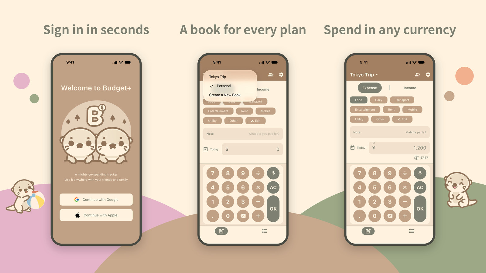
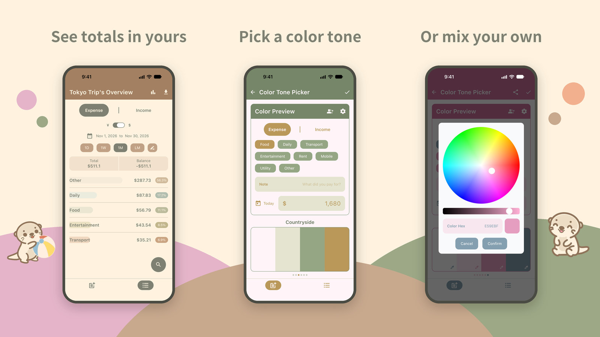

# Budget+ Multiplatform App（極簡記帳）

[](https://github.com/kevinguitar/budgetplus/actions/workflows/ci.yml)
[](https://polyformproject.org/licenses/noncommercial/1.0.0)

Budget+ is an easy-to-use shared budget tracker. Track spending together with automatic currency conversion.

### Now available on both Android and iOS!

[](https://play.google.com/store/apps/details?id=com.kevlina.budgetplus)
[](https://apps.apple.com/app/id6759791430)

## Feature Overview





### Some cool animated features!! ✨
|                                                      Pie Chart                                                       |                                                  Color Tone Picker                                                   |                                                 Customize Color Tone                                                 |
|:--------------------------------------------------------------------------------------------------------------------:|:--------------------------------------------------------------------------------------------------------------------:|:--------------------------------------------------------------------------------------------------------------------:| 
| <video src="https://github.com/kevinguitar/budgetplus-android/assets/18852983/c2222bc4-f78e-42a2-a78b-ebdb78cc7c2e"> | <video src="https://github.com/kevinguitar/budgetplus-android/assets/18852983/82f6d3e9-8162-4554-809e-e2f81913e684"> | <video src="https://github.com/kevinguitar/budgetplus-android/assets/18852983/bece0f6d-2f49-4562-b24e-4ff51cf5d5a8"> |

---

## Tech Stack

### Business Logic and Core
- [Kotlin Multiplatform](https://kotlinlang.org/docs/multiplatform.html) for shared logic across Android and iOS
- [Compose Multiplatform](https://www.jetbrains.com/lp/compose-multiplatform/) for shared UI + MVVM Architecture
- [Coroutines](https://kotlinlang.org/docs/coroutines-overview.html) & [Flow](https://kotlinlang.org/docs/flow.html) for asynchronous operations
- [Metro](https://zacsweers.github.io/metro/latest/) for dependency injection
- [Navigation3](https://developer.android.com/guide/navigation/navigation-3) for Composable navigation
- [DataStore](https://developer.android.com/topic/libraries/architecture/datastore) for persistent data storage
- [RevenueCat](https://github.com/RevenueCat/purchases-kmp) for in-app purchases and subscriptions
- [AdMob](https://admob.google.com/home/) with Meta Audience Network mediation for ads
- [Kotlinx Serialization](https://github.com/Kotlin/kotlinx.serialization) for JSON parsing
- [Kotlinx Datetime](https://github.com/Kotlin/kotlinx-datetime) for date and time handling
- [Firebase](https://firebase.google.com/)
  - [Firestore](https://firebase.google.com/docs/firestore) for real-time database
  - [Authentication](https://firebase.google.com/docs/auth) for Google and Apple ID sign-in
  - [Crashlytics](https://firebase.google.com/docs/crashlytics) for crash reporting
  - [Analytics](https://firebase.google.com/docs/analytics), [Messaging](https://firebase.google.com/docs/cloud-messaging), and [Remote Config](https://firebase.google.com/docs/remote-config)

### Open-Source Libraries for KMP
- [Calf](https://github.com/MohamedRejeb/Calf) for native iOS look and feel
- [Coil3](https://github.com/coil-kt/coil) for image loading with KMP support
- [Colorpicker-compose](https://github.com/skydoves/colorpicker-compose) for color picking
- [Compottie](https://github.com/alexzhirkevich/compottie) for Lottie animations in Compose Multiplatform
- [CrashKiOS](https://github.com/touchlab/CrashKiOS) for better crash reporting on iOS
- [Csv](https://github.com/sergejsha/csv) for exporting data as CSV (KMP)
- [Firebase Kotlin SDK](https://github.com/GitLiveApp/firebase-kotlin-sdk) for KMP support
- [Kermit](https://github.com/touchlab/Kermit) for logging
- [Keval](https://github.com/notKamui/Keval) for mathematical expression evaluation
- [Moko-permissions](https://github.com/icerockdev/moko-permissions) for KMP permission handling
- [Reorderable](https://github.com/Calvin-LL/Reorderable) for reordering items in Compose

### Android Specific
- [In-App Review](https://developer.android.com/guide/playcore/in-app-review) and [In-App Update](https://developer.android.com/guide/playcore/in-app-updates) integration
- [Baseline Profile](https://developer.android.com/topic/performance/baselineprofiles/overview) for improving app startup time

---

## Supported Deeplinks
- Home screen: https://budgetplus.cchi.tw/record
- Overview: https://budgetplus.cchi.tw/overview
- Unlock premium: https://budgetplus.cchi.tw/unlockPremium
- Settings: https://budgetplus.cchi.tw/settings
- Settings with members dialog: https://budgetplus.cchi.tw/settings?showMembers=true
- Sharing customized color tones: https://budgetplus.cchi.tw/colors?hex=cff1ff%3bdaf2cb%3b84c18f%3b596980

---

## Performance Optimization (Baseline Profile)

The project uses [Baseline Profiles](https://developer.android.com/topic/performance/baselineprofiles/overview) to improve startup performance.

### Generating a Profile

The profile is generated automatically on every Play Store publish (see
[`.github/workflows/publish-android-app.yml`](.github/workflows/publish-android-app.yml)). It is produced by the
[`androidx.baselineprofile`](https://developer.android.com/topic/performance/baselineprofiles/configure-baselineprofiles)
plugin, which runs the `:benchmark` generator against the app's `nonMinifiedRelease`
variant. That variant sets `is_ui_test=true`, so it routes Firebase to the local
emulators and signs in anonymously (Google Sign-In is unavailable on CI).

To regenerate the profile locally:

1. Start an Android emulator and the Firebase Auth + Firestore emulators:
   ```bash
   firebase --config ui-tests/config/firebase.json --project budgetplus-ui-tests \
     emulators:start --only auth,firestore
   ```
2. Forward the emulator ports so the app can reach the Firebase emulators:
   ```bash
   adb reverse tcp:9099 tcp:9099 && adb reverse tcp:8080 tcp:8080
   ```
3. Run the generator:
   ```bash
   ./gradlew :androidApp:generateBaselineProfile
   ```

The plugin merges the result into `androidApp/src/main/generated/baselineProfiles/baseline-prof.txt`,
which is consumed by every release build. This path is git-ignored because it is a
generated artifact.

### Running Macrobenchmarks
```bash
./gradlew :benchmark:connectedReleaseAndroidTest -P android.testInstrumentationRunnerArguments.androidx.benchmark.enabledRules=Macrobenchmark
```

---

## Build the Project Locally

1. Clone the repository.
2. Copy the dummy Firebase config used by the UI tests into the Android app module:
   ```bash
   cp ui-tests/config/google-services.json androidApp/google-services.json
   ```
3. Build:
   - Android app: `./gradlew :androidApp:assembleDebug`
   - Shared iOS framework: `./gradlew :shared:linkDebugFrameworkIosSimulatorArm64`
4. To build the iOS app in Xcode, also copy the dummy iOS config. Debug builds swap in the staging config, so both paths are needed:
   ```bash
   cp ui-tests/config/GoogleService-Info.plist iosApp/iosApp/GoogleService-Info.plist
   mkdir -p iosApp/Firebase/Stage
   cp ui-tests/config/GoogleService-Info.plist iosApp/Firebase/Stage/GoogleService-Info.plist
   ```

The dummy configs are only enough to compile. For a working app, create your own Firebase project and replace them with its config files and API keys.

### iOS Swift package dependencies

Native iOS SDKs are declared with Kotlin's [SwiftPM import](https://kotlinlang.org/docs/multiplatform/multiplatform-spm-import.html), an Alpha feature that requires Kotlin 2.5.0-Beta1 or newer:

- `shared/build.gradle.kts`: Firebase and Google Sign-In
- `core/ads/build.gradle.kts`: Google Mobile Ads

The `Shared` framework is still static, and its API is still Objective-C based. SwiftPM import doesn't change either one.

Firebase is linked through SwiftPM, but its Kotlin bindings still come from GitLive. Implicit Clang-module discovery is disabled so Firebase bindings aren't generated twice. Google Sign-In and Google Mobile Ads are accessed through the generated `swiftPMImport` namespaces.

#### Updating native dependencies

After changing a native dependency, regenerate the Xcode linkage package:

```bash
XCODEPROJ_PATH="$PWD/iosApp/iosApp.xcodeproj" ./gradlew :shared:integrateLinkagePackage
./gradlew :shared:fetchSyntheticImportProjectPackages
```

Commit:

- every file in `iosApp/KotlinMultiplatformLinkedPackage`, including empty source stubs
- `.swiftpm-locks/default/swiftImport/Package.resolved`
- `iosApp/iosApp.xcodeproj/project.xcworkspace/xcshareddata/swiftpm/Package.resolved`

The rest of `.swiftpm-locks` is regenerated and git-ignored. In Xcode, run **File → Packages → Resolve Package Versions** before rebuilding.

#### Xcode project constraints

- Meta Audience Network mediation is still an Xcode package dependency, not a SwiftPM import.
- Keep the `-ObjC` linker flag in `iosApp/Configuration/Config.xcconfig`. The Meta adapter is discovered at runtime, and this flag keeps the linker from stripping it.
- Don't also force-load the Meta artifact. That would link it twice.
- Keep the Crashlytics upload build phase.

Before exporting the IPA, the publish workflow checks that `GADMediationAdapterFacebook` is still in the stripped Release archive. To run the same check locally:

```bash
python3 iosApp/scripts/verify_meta_adapter.py build/iosApp.xcarchive
```

This check only catches a missing or stripped adapter. It doesn't prove that ads are delivered. Before shipping ad SDK changes, use Ad Inspector on a real device to verify Meta bidding and test-ad delivery.

---

## UI Tests

UI tests use [Maestro](https://maestro.mobile.dev/) to drive the real Android and iOS apps. Both platforms run the same flows from `ui-tests/` against local Firebase Auth and Firestore emulators, so production data is never touched.

Flows are split into three independent suites: `login/` (auth and onboarding), `after-login/free/`, and `after-login/premium/`. Shared subflows live in `common/`. See [`ui-tests/TEST_COVERAGE.md`](ui-tests/TEST_COVERAGE.md) for the coverage map, test-mode hooks, and selector strategy.

### Adding a Test

1. Add a Maestro YAML flow to the relevant suite. The runners pick up every flow in a suite automatically.
2. Select elements by stable visible text, which Maestro reads the same way from Android and iOS accessibility trees. Add custom semantics only when there's no stable text, and verify the selector on both platforms.
3. Avoid platform-specific commands so one flow runs on both platforms. If a flow is genuinely platform-specific, add a top-level `platform: Android` or `platform: iOS` key, and the other platform's runner will skip it.

### Running Locally

Install the [Firebase CLI](https://firebase.google.com/docs/cli) and the [Maestro CLI](https://docs.maestro.dev/maestro-cli/how-to-install-maestro-cli). For Android, also install **Android SDK Command-line Tools (latest)** from the SDK Tools tab in Android Studio.

Each platform has a setup script that creates and boots a dedicated test device.

Android:

```bash
./ui-tests/scripts/setup-local-android-emulator.sh
EMULATOR_AVD=budgetplus_ci_api34 ./ui-tests/scripts/run-android-ui-tests.sh
```

iOS:

```bash
./ui-tests/scripts/setup-local-ios-simulator.sh
./ui-tests/scripts/run-ios-ui-tests.sh "iPhone 17 Pro UI Tests"
```

Don't point the iOS runner at a simulator you use day to day. The runner resets the simulator's keychain, and an installed Stage build can intercept the shared `budgetplus://` URL scheme used to seed premium.

Both runners temporarily install the test Firebase config and restore your original file, or remove it if there wasn't one, even when tests fail. Reports and per-attempt diagnostics go to `build/maestro/{android,ios}`.

To run a single suite or filter flows, see [`TEST_COVERAGE.md`](ui-tests/TEST_COVERAGE.md#running-locally). That guide also covers retry reporting and the device-free runner checks.

---

## Backend: Firebase Cloud Functions

Database interactions and push notifications are implemented using [Firebase Cloud Functions](https://firebase.google.com/docs/functions). 

The backend repository is also open-sourced: [budgetplus-cloud-functions](https://github.com/kevinguitar/budgetplus-cloud-functions)

---

License
-------

    Copyright (c) 2024 Kevin Chiu

    Licensed under the PolyForm Noncommercial License 1.0.0 (the "License");
    you may not use this file except in compliance with the License.
    You may obtain a copy of the License at

    https://polyformproject.org/licenses/noncommercial/1.0.0

    This software may be used for any noncommercial purpose only.
    Commercial use, including monetization, is not permitted.
    See the License for the specific terms governing permissions and
    limitations under the License.
